<picture>
  <source media="(prefers-color-scheme: dark)" srcset="https://raw.githubusercontent.com/GoCarbonTracker-Hq/.github/main/profile/about-dark.svg">
  
</picture>

[gocarbontracker.net](https://gocarbontracker.net) · [global-esg-law](https://github.com/GoCarbonTracker-Hq/global-esg-law) · [go-carbon-tracker](https://github.com/GoCarbonTracker-Hq/go-carbon-tracker)

<!-- The card is drawn with github.com/pedrocatalao/github-cool-readme from profile/cool-readme.yml (about card only, --from-snapshot, no token). Redraw and commit both SVGs when the text changes. -->
