<picture>
  <source media="(prefers-color-scheme: dark)" srcset="https://raw.githubusercontent.com/GoCarbonTracker-Hq/.github/main/profile/about-dark-3.svg">
  
</picture>

- [go-carbon-tracker](https://github.com/GoCarbonTracker-Hq/go-carbon-tracker): reads company reports and traces each figure to its page. Alpha, experimental.
- [global-esg-law](https://github.com/GoCarbonTracker-Hq/global-esg-law): ESG-relevant law as dated git history, to look up what was in force in a place on any date.

[gocarbontracker.net](https://gocarbontracker.net)

<!-- The card is drawn with github.com/pedrocatalao/github-cool-readme from profile/cool-readme.yml (about card only, --from-snapshot, no token). When the text changes, redraw, commit both SVGs under a new file name and update the two links above (GitHub caches images by path). -->
